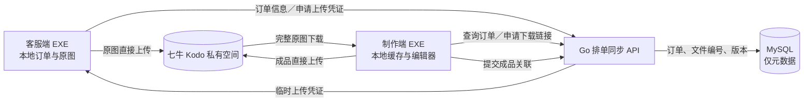

# 七牛原图与成品同步接入方案（评审稿）

日期：2026-11-19。状态：供评审，尚未实施。

## 1. 建议先确认的结论

推荐采用：**本地 SQLite 和文件缓存 + Go 同步 API + MySQL 元数据 + 七牛 Kodo 私有空间**。

- 七牛保存原图和成品文件；MySQL 不新增图片二进制内容。
- 两地 EXE 通过同步 API 获取订单、凭证和文件信息；文件直接在 EXE 与七牛之间传输。
- Go API 签发七牛短期上传凭证、下载链接，核对上传结果并提交订单版本。
- 两地各自保留 EXE 旁的 `data/`，图片下载完成后可离线制作。
- 列表缩略图在本地由原图生成，第一期不要求上传缩略图，也不依赖七牛图片处理。
- 排单、模板数量、原图、成品使用同一套同步流程。模板图片仍随 EXE 发布，两端需使用匹配的模板版本；首期不加入模板文件和可编辑画板工程同步。

这是对现有同步架构的调整，并非只增加一组七牛配置。

## 2. 当前工程的实际情况

| 位置 | 已有能力 | 需要处理的差距 |
| --- | --- | --- |
| `src-tauri/src/store.rs` | 原图字节本地保存、SQLite 订单、模板关联、缩略图、导入素材 | 增加持久化同步任务、文件校验、同步版本及状态 |
| `src-tauri/src/mysql.rs` | 订单上传和轮询；存在 `order_images`、`productions` 的 BLOB 表结构 | 当前 `push_order` 未上传素材；新七牛模式改走元数据 API，停止原有 BLOB 同步 |
| `src-tauri/src/cloud.rs` | MinIO/S3 上传、manifest、下载导入 | 当前是独立同步通道，不能仅替换域名便视为已接入七牛 |
| `src-tauri/src/lib.rs` | 排单后触发同步、启动回填、定时拉取 | 调整为统一同步协调器，消除重复任务和两条通道并行写入 |
| `src-tauri/src/commands.rs` | 修改模板、保存成品 | 本地保存后写入待同步任务，上传失败仍能重试，不把本地成品误报为未保存 |
| `src/views/SettingsView.vue` | MySQL、MinIO 配置、手动同步 | 新增七牛同步模式、连接诊断、同步状态和任务入口 |
| 仓库 `server/` | Go API、MySQL 接入、共享资源登录、迁移和部署基础 | 新增独立 paidan 模块、桌面端认证、七牛凭证及订单接口 |

现有 MySQL 和 MinIO 都使用本地 `orders.cloud_hash`，两种值含义不同。七牛模式使用独立的服务端订单版本及本地已应用版本，停止让旧通道改写该同步标记。

Go API 的现有网页资源接口采用 Cookie 和 Origin 校验，上传还有 25 MB 与格式限制。排单客户端不能直接套用该接口，否则可能遇到认证、文件大小或格式不一致。新增 paidan 路由和桌面端认证，保持网页接口原有行为。

仓库 README 记载已有 Go API 部署，但本次未验证现网配置与网络。尤其不能假定 Go API 已能访问排单所用的 MySQL，也不能假定网页共享库和排单库是同一个数据库。

## 3. 接入方式比较

| 方式 | 特点 | 建议 |
| --- | --- | --- |
| 七牛原生接口 + Go API 签发临时凭证 | EXE 不保存七牛 SK；服务端统一核对文件和提交订单；可撤销设备访问 | **推荐，作为本稿设计基线** |
| 七牛原生接口 + EXE 本地保存 AK/SK，继续直连 MySQL | 少部署一个服务，但凭证分散在各设备，权限与轮换难统一；需要接受客户端长期持有存储权限 | 仅作为明确不部署 API 时的替代方案，需另行评审 |
| 七牛 S3 兼容接口 | 可评估复用部分 S3 客户端，但仍须验证区域端点、签名和兼容行为，也不能解决现有同步一致性问题 | 不作为首期接入路径 |

七牛原生上传凭证与当前自写 S3 SigV4 的认证方式不同。本方案服务端优先使用七牛官方 Go SDK；桌面端优先评估官方 Rust 上传、下载与 Etag 组件，凭证由 API 提供，不在 EXE 内生成长期权限凭证。SDK 版本和 Windows/Tokio 兼容性在技术验证阶段锁定。

## 4. 总体结构



API 不中转正常图片流量，只处理小体积请求、凭证和元数据。服务器需要能访问排单 MySQL 与七牛管理接口；两地 EXE 需要能访问 API 和七牛上传、下载域名。

推荐复用仓库现有 `server/` 的框架和部署能力，新增独立模块。部署位置选择能访问排单 MySQL 的环境；如果现有服务所在网络无法访问该库，需先解决部署位置或网络可达性，而不是直接上线接口。

## 5. 文件、密钥与七牛配置

### 5.1 七牛空间

- 使用私有 Bucket；首期使用可即时读取的标准存储。
- 上传区域根据真实 Bucket 所属区域解析或配置，区分上传端点、管理端点和下载域名。
- 下载域名须已绑定该空间并可通过 HTTPS 访问；不默认使用临时测试域名作为正式入口。
- 原图和成品不附加缩放、质量压缩、转码等处理参数。
- 用服务端生成的固定空间标识与资源 ID 组织对象路径，不使用电脑盘符或客户原始文件名作为唯一标识。

建议对象路径：

```text
paidan/v1/<业务空间ID>/originals/<素材ID>.<扩展名>
paidan/v1/<业务空间ID>/productions/<成品ID>.<扩展名>
```

文件发布后内容不可原位覆盖；换图创建新素材 ID 和对象路径。重试继续使用同一任务对应的 ID 与路径，避免反复生成重复对象。首期不做跨订单的全局文件去重。

费用需要按实际区域和套餐核算，主要由累计文件容量、下载流量及请求次数组成。可用“每日原图与成品字节量 × 保留天数”估算容量，以“文件大小 × 实际下载副本次数”估算下行流量。本地校验缓存可减少重复下载，但不预先承诺固定费用或跨地区传输速度。

### 5.2 凭证

- 七牛 AK/SK 只配置在 Go API 的服务端环境中。
- EXE 使用可撤销的设备凭证访问 API；服务端保存设备凭证的摘要及权限，不把七牛 SK 发给 EXE。
- 首期在服务端配置设备凭证及所属业务空间，不另建完整账号管理界面；客户端凭证由 Windows DPAPI 加密后存放在本地 `data/`，设备标识与连接信息也保存在该目录，不读取旧 AppData 配置。
- 复制 EXE 和 `data/` 可以保留订单与图片；复制到另一台电脑时，机器绑定的凭证需要重新接入，不默认复制后继承原设备授权。
- 设备权限至少区分客服、制作、管理员；具体订单查询与上传权限由服务端检查。
- 上传凭证绑定明确的 `bucket:key`，只允许新增对应文件，并限制体积和有效期。建议上传凭证 30 分钟、下载链接 15 分钟，支持续领。
- MySQL 保存 `provider/bucket/object_key` 等稳定信息，不持久化临时签名链接；日志也不记录完整凭证、签名查询参数或 SK。

七牛上传凭证中包含可见的 AK 标识，这是协议组成；客户端不持有用来签发凭证的 SK。

## 6. 三条业务流程

### 6.1 客服端确认排单

1. 捕获图片，按原始字节落入 EXE 旁的 `data/images`；生成本地缩略图。
2. 在本地事务中写入订单、模板数量和同步任务。成功后显示“已保存本地，等待同步”。磁盘与 SQLite 不构成同一个事务，落盘失败不入库；孤立文件可保留待核查。
3. 同步任务以流式方式计算文件大小、SHA-256 和七牛 Etag，向 API 申请上传会话。服务端确定对象路径和权限。
4. EXE 将原文件直接上传七牛。大文件采用分片上传并保存续传信息；支持的断点条件由 SDK 技术验证确认，不能仅凭“分片”就宣称重启后可续传。
5. EXE 请求上传完成确认。API 查询七牛对象信息，核对目标 key、文件大小与七牛 Etag。不能只相信客户端上报“上传成功”。
6. API 在 MySQL 事务中发布已就绪素材、订单关联及模板数量，并增加订单版本。尚未上传完成的素材不出现在远端可用素材列表。
7. 客服端将任务标记为已同步，展示服务器确认时间。多张图片逐张发布，同一订单可显示“已同步 2/3 张”；不同步骤失败不会丢掉其余待传任务。

订单可以先在服务端登记为“待素材”，制作端能看到等待状态；仅 `ready` 素材可下载和制作。新增素材按 ID 追加，不能用某台机器的旧素材列表覆盖整个订单。

### 6.2 另一地区接收素材

1. 默认每 15 秒分页查询该业务空间的订单号与版本，允许配置为 10–60 秒，并提供“立即同步”。
2. 对版本变化的订单，取得一个包含订单版本、素材列表、模板数量和文件校验信息的一致快照。
3. 已有且校验通过的本地原图直接复用；缺失或损坏的文件进入下载任务。初始建议最多同时处理 2 个文件。
4. 按资源 ID 向 API 获取临时下载链接，下载到同目录的 `.part` 临时文件。链接过期重新申请，不把过期链接长期缓存。
5. 校验文件大小与 SHA-256 后，原子更名为正式文件；生成本地缩略图，事务导入本地数据库，再更新素材列表。
6. 该快照所需文件与元数据全部成功应用后，才记录本地已应用版本。失败保留待下载状态与任务；不能提前推进版本导致后续不再重试。
7. 下载过程又有服务器更新时，本轮完成后继续获取下一版本，不丢掉新图片。重复拉取不重复创建素材。

首期的轮询是分页的轻量订单版本清单比较，不用当前秒级时间戳作为唯一判断依据，也不把“所有订单的最大版本号”当成全局游标。以后订单量增大，再引入独立增量变更日志。

缩略图用于列表，原图用于编辑器。原图未完成下载时显示“素材下载中”，不把缩略图作为原图注入制作。

### 6.3 制作端回传成品

1. 导出后先保存本地成品与同步任务，提示“成品已保存本地，待回传”。
2. 通过同一上传会话流程将 PNG 等原始成品文件上传七牛。
3. 完成确认后，服务端记录成品 ID、订单号、源素材 ID（存在时）、对象路径和校验值，推进订单版本。
4. 客服端下轮同步收到成品并下载。上传失败不删除本地成品，重新启动后继续重试。
5. 未关联订单的导出，首期继续仅保存本地，不自动归入远端客户订单。

成品文件完整传输保留其现有 DPI 等文件信息；本次不改变编辑器已有导出算法。

## 7. 无损的定义与验证

**验收目标：客服端捕获并保存的原始文件，与制作端下载的文件 SHA-256 完全相同。**

- 原图直接传文件字节，不经 Canvas 二次编码、不因体积大而静默压缩。
- 七牛 Etag 是七牛自己的校验算法，不能当成 SHA-256。
- 上传端提供 SHA-256 与七牛 Etag；API 用七牛对象信息核对大小和 Etag。首期 API 不逐张下载图片复算 SHA-256，因此不能把 API 确认称为服务端 SHA-256 复验。
- 下载端独立重算 SHA-256，与发布的校验值比较；不一致则拒绝标记就绪并重试。
- 现有千帆捕获代码会在取原图失败时退回缩略图，并标记 `scaled`。该标记目前未完整保存到素材同步元数据，需增加 `source_quality=original/scaled/unknown`。
- 取到缩图或来源质量未知时明确提示，不能称为已取得平台原图。同步完整字节不等于恢复平台之前压缩掉的内容。

首版建议单文件最大 100 MiB，配置可调整；这是拟议的产品限制，不是七牛自身上限。现有捕获层最大为 512 MiB，如需保留该上限，应在评审中选定并进行大文件验收。PNG/JPEG/WebP/GIF 按原格式存储，不为了复用网页旧上传接口而统一转 PNG。

## 8. MySQL 与本地数据设计

建议使用独立的 `paidan_*` 元数据表，避免与现有 `orders/order_images/productions` BLOB 表或网页 `pic_*` 表混用。由 Go API 独占七牛模式的元数据写入，桌面端通过 API 同步。

| 新表/数据 | 关键内容 |
| --- | --- |
| `paidan_orders` | 业务空间、订单号、服务器版本、订单描述、删除标记 |
| `paidan_assets` | 资源 ID、原图/成品类型、七牛 bucket/key、SHA-256、七牛 Etag、大小、MIME、尺寸、来源质量、pending/ready 状态 |
| `paidan_order_images` | 订单与素材关联、模板编号和数量 JSON、删除标记 |
| `paidan_productions` | 成品 ID、订单、可选源素材 ID、资源 ID、创建时间 |
| `paidan_upload_sessions` | 幂等请求 ID、设备、目标资源、对象路径、会话状态、有效期 |
| `paidan_devices` | 设备 ID、业务空间、权限、凭证摘要、撤销状态 |
| 本地 SQLite 同步表 | 上传/下载任务、重试次数、下次尝试时间、续传信息、错误摘要、服务器版本与已应用版本 |

所有新表不包含图片 BLOB。已有 BLOB 数据暂时保留，不在接入时直接删表或清空。

服务端版本在订单事务内锁定并递增，不能依赖设备时间。模板编辑携带预期版本；冲突时返回 409 并保留本地修改供处理，不自动覆盖他人操作。删除使用显式删除标记；本地文件缺失不代表远端删除。

客户端不把下载得到的数据再次作为新增素材上传，避免两端来回复制。服务端使用幂等请求 ID 处理“已提交但客户端没收到响应”的重试。

## 9. 拟议 API

以下为新接口设计，不是当前已经存在的接口。

| 接口 | 目的 |
| --- | --- |
| `POST /api/v1/paidan/upload-sessions` | 校验设备和订单权限，按幂等请求 ID 创建/恢复上传会话，返回目标 key、上传端点及短期凭证 |
| `POST /api/v1/paidan/upload-sessions/{id}/complete` | 查询七牛对象，核对并事务发布素材/成品；重复确认返回相同结果 |
| `GET /api/v1/paidan/orders` | 分页读取当前业务空间的订单号、版本与删除状态 |
| `GET /api/v1/paidan/orders/{number}` | 读取一致的订单元数据快照及已就绪资源列表 |
| `POST /api/v1/paidan/assets/{id}/download-url` | 先校验访问权限，再签发短期下载链接 |
| `PATCH /api/v1/paidan/orders/{number}/images/{id}/templates` | 带预期版本更新模板数量 |
| `DELETE /api/v1/paidan/orders/{number}/images/{id}` | 软删除关联并推进版本；不立即删除七牛对象 |

客户端不提交任意 key 来要求签名，须使用业务资源 ID；对象路径由服务端确定。第一期可通过再次调用创建接口为同一上传会话续领凭证；若分片续传所需权限不同，在技术验证时明确相应接口契约。

Go API 当前的 `/api/v1/*path` 转交网页 library 处理，需要改为按 paidan 命名空间分发，避免新路由被旧处理器拦截。桌面端使用独立设备认证，不放宽网页原有 Cookie/Origin 校验。

## 10. 失败恢复、日志与界面

| 情况 | 处理 |
| --- | --- |
| 本地保存成功，API/七牛离线 | 保留任务和原图，后台恢复重试；本地制作仍可使用 |
| 上传成功，MySQL 提交失败 | 保留同一会话与对象路径，重试完成确认，不重新造一个素材 |
| 服务端已发布，客户端没收到响应 | 幂等确认返回原资源和版本，不重复追加 |
| 凭证过期 | 续领上传凭证/下载链接；已完成文件不重新上传 |
| 下载中断/进程退出 | 保留可验证的续传记录或 `.part`；不将半文件作为正式素材 |
| 本地有文件但校验失败 | 标记待修复并重新下载；文件“存在”不等于完整 |
| 没权限/配置错误 | 展示可定位错误，等待修正；避免无限高频重试 |
| 临时网络错误、限流、服务器错误 | 退避重试，建议 5 秒、15 秒、60 秒，之后最多每 5 分钟，并加入随机抖动 |
| 未被订单引用的七牛对象 | 记录为待核查；首期不自动物理删除，不因暂时未提交成功而误删 |

界面至少展示“已保存本地 / 等待上传 / 上传中 / 已同步服务器 / 下载中 / 下载完成 / 同步失败”。“已同步服务器”不代表另一台机器已下载完成；要显示对端接收确认，需要另加设备回执，不作为首期默认承诺。

设置页新增“七牛同步”模式、API 地址、设备接入、连接检查、立即同步、待处理数量和打开日志入口。开启新模式后，本实例旧 MySQL/MinIO 同步 worker 不再启动。编辑器内不展示存储接口等实现细节。

本地日志记录任务 ID、订单、阶段、进度、耗时、七牛请求 ID 和错误类别，方便定位问题；敏感凭证与签名参数不进入日志。首期不另建 Redis/队列集群，本地 SQLite 队列与 MySQL 会话表即可承载这些任务。

## 11. 迁移、发布与回退

1. 先在独立七牛测试前缀和测试库中验证权限、文件完整性、SDK 续传与两端流程。
2. 给 Go API 增加可关闭的 paidan 模块和独立排单数据库配置。该模块可复用服务框架，但连接哪一个数据库须显式指定。
3. 先部署新服务与元数据表，再发布有七牛模式的 EXE。只有切换新模式的实例使用新协议。
4. 使用本地 SQLite 中现有的订单和关联原图进行可恢复补传，保留原素材 ID；模板及来源质量一并迁移。仅存在于旧 MySQL BLOB 的文件需要单独导出迁移，不能遗漏。
5. 没有订单关联的归档文件不自动恢复为订单，避免此前用户不希望旧数据重新出现的问题。
6. 历史 `scaled` 信息无法可靠恢复时标记为 unknown，不能统一标成原图。
7. 切换按业务空间统一安排：同一空间的参与机器不能继续让旧程序向旧通道写入；升级期间旧端可本地保存，但暂停旧远端同步。
8. 观察两地同步与历史补传后再决定旧存储清理策略。首期不删除本地原图、旧 BLOB、旧配置或已有七牛文件。
9. 回退可暂停七牛同步，保留现有本地数据继续制作；不能仅靠切回旧二进制恢复新协议产生的全部远端订单。需要回旧通道时先导出/核对新数据。

Go API 不套用旧网页图片上传的 25 MB 上限，因为文件直传七牛；仍需配置 paidan 自己的文件限制和允许格式。现有网页共享素材、AI 抠图和编辑器导出不是此次存储迁移的改造对象。

## 12. 实施顺序与验收

| 阶段 | 交付与退出条件 |
| --- | --- |
| A：七牛技术验证 | 私有原图上传/下载、签名过期续领、区域与域名、大小/Etag/SHA-256、Windows SDK、大文件中断重启验证通过 |
| B：最小两地闭环 | 客服端排单 → 七牛就绪 → API 发布订单 → 制作端下载 → 左侧显示 → 点击制作读原图 |
| C：稳定性与成品 | 持久化任务、断网重启、幂等、模板冲突、同秒多图、成品回传、日志与状态 |
| D：迁移和正式切换 | 历史补传、两端统一切换、旧通道停用、运行说明与回退演练 |

必须通过的验收：

- 两个独立 EXE/data 环境，对同一订单正常传图、显示缩略图、关联正确模板与数量；非仅在同一机器共享目录验证。
- JPEG、透明 PNG、WebP 等支持格式下载后与上传前 SHA-256 完全相同；保持文件字节及原有元数据。
- 同一秒添加多张图、同订单连续排单、文件同名，均不漏图、不重复创建。
- 客服端已上传而 API 提交暂时失败、制作端下载中断、两端进程重启，均能补齐。
- 链接过期可续领；无权设备不能获取其他空间的上传权限或下载链接。
- 原图未下载完整时不能拿缩略图进入制作；非原图来源有明确标记。
- 修改模板不重新上传未变化原图；成品导出先本地保存，再成功回传。
- 新模式 MySQL 不新增原图或成品 BLOB；旧模式 worker 不并行写入同一业务空间。
- 服务端已同步与对端已接收在界面上不混淆；服务异常不清空本地订单或未保存制作内容。

这些是计划验收项，本次方案整理尚未进行七牛账号内的上传/下载或修改任何现网配置。

## 13. 本轮评审需要决定的事项

1. 是否采用“现有 Go 服务扩展 paidan 模块 + EXE 七牛直传”的推荐架构。此选择意味着新模式逐步替代 EXE 直连 MySQL 的同步方式。
2. 七牛使用现有哪个私有 Bucket、所属区域、可用的 HTTPS 下载域名；是否需要为排单独立空间。现有空间可复用，但权限及路径要明确。
3. Go API 能否访问排单使用的 MySQL；如不能，决定部署在哪里或如何打通网络。
4. 单文件上限是否采用建议 100 MiB，还是保留现有捕获层的 512 MiB；其他建议初值为 15 秒轮询、2 文件并发。
5. 首期是否同意覆盖原图、模板数量和成品，删除先软删除、本地缩略图生成、暂不自动物理清理。具体保留期限在启用自动清理前另行确定。

评审阶段无需提供 AK/SK。确认方案后，实施时通过服务端配置接入实际凭证。

## 14. 官方资料与证据边界

2026-11-19 核对了以下官方材料；未以本次查阅代替真实 Bucket 的兼容性和连通性验证。

- [七牛上传凭证](https://developer.qiniu.com/kodo/1208/upload-token)：权限范围、有效期和服务端签发。
- [七牛私有资源下载](https://developer.qiniu.com/kodo/1656/download-private)：短期签名链接、过期响应和服务端时间校准。
- [七牛区域和访问域名](https://developer.qiniu.com/kodo/1671/region-endpoint-fq)：不同区域的上传、下载和管理端点。
- [七牛官方 Rust SDK](https://github.com/qiniu/rust-sdk)：上传、下载、Etag 和认证组件，异步与 HTTP 客户端选项。

目前尚未确认真实 Bucket 的区域、空间权限、域名、账号可用功能、配额和具体费用。需要用用户实际配置在阶段 A 验证，不把文档中的通用能力写成现网已可用的结论。
